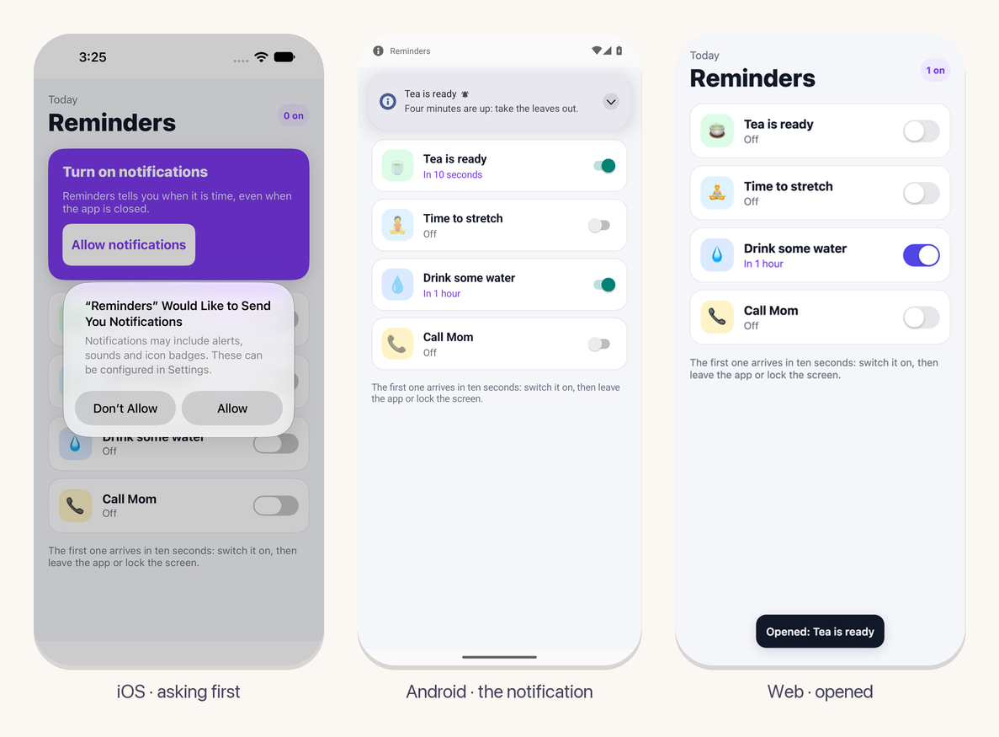

<p align="center">
  
</p>

<h2 align="center">notifications</h2>
<p align="center">Local notifications for apps on eskiu-lang/ui.</p>
<p align="center"><sub>Part of the <a href="https://github.com/eskiu-lang">Eskiu</a> project</sub></p>
<p align="center">
  <a href="https://eskiu-lang.org/ui.html">eskiu-lang.org/ui</a> &nbsp;&middot;&nbsp;
  <a href="#use-it">Use it</a> &nbsp;&middot;&nbsp;
  <a href="examples/reminders">Example</a> &nbsp;&middot;&nbsp;
  <a href="https://github.com/eskiu-lang/ui">ui</a>
</p>

<p align="center">
  <a href="https://github.com/eskiu-lang/ui-notifications/actions/workflows/ci.yml"></a>
  
  <a href="LICENSE"></a>
</p>

---

The app schedules a notification with a title and a body for a number of seconds from now. The
system shows it then, also when the app is in the background or closed, and tells the app
when the user opens it. Each platform's own service keeps them: `UNUserNotificationCenter` on
iOS, `AlarmManager` and `NotificationManager` on Android, and the Notification API on the web.



## Add it

In an app made with `ui new`:

```bash
eskiuc add notifications --git https://github.com/eskiu-lang/ui-notifications
```

Its `ui.toml` brings the UserNotifications framework on iOS, and on Android the
`POST_NOTIFICATIONS` permission and the receiver that posts a notification when its alarm goes
off.

## Use it

```eskiu
import <ui/kit>;
import <notifications>;

void Tea() {
    Column(Style{padding: 20, gap: 12}, void() {
        int permission = use_notification_permission();
        use_notification_opened(void(string id) { kit_toast("Your tea is ready"); });
        if (permission != NotificationsAllowed) {
            Button("Allow notifications", void() { notifications_ask(); });
        }
        Button("Remind me in four minutes", void() {
            notification_schedule("tea", "Tea is ready", "Take the leaves out.", 240);
        });
    });
}
```

| Name | What it is |
|---|---|
| `use_notification_permission()` | Whether the app may show notifications, while the scope is mounted: `NotificationsChecking` until the platform answers, then `NotificationsNotAsked`, `NotificationsAllowed` or `NotificationsDenied`. The scope renders again when it changes. |
| `notifications_ask()` | Ask the user. The system asks once; after that it answers with what the user chose (change it in the system's settings). |
| `notification_schedule(id, title, body, seconds)` | Show a notification `seconds` from now (at least 1). One scheduled with the same `id` replaces it. |
| `notification_cancel(id)` | Cancel a scheduled notification, and take it away if it is showing. |
| `use_notification_opened(fn(string id))` | The id of each notification the user opens while the scope is mounted, and, when it mounts, the one that opened the app. |

## Platforms

| Platform | Scheduling | Opening |
|---|---|---|
| iOS | `UNTimeIntervalNotificationTrigger`; a notification that arrives while the app is in front shows as a banner too | The delegate is set before the app finishes launching, so one that opens a closed app reaches it |
| Android | `AlarmManager.setAndAllowWhileIdle` wakes `NotificationAlarm`, which posts on the app's channel (high importance, so it pops up) | The tap opens the app with the id in the intent, also from a closed app |
| Web | A timer in the page: it shows only while the page is open | A click focuses the page |

Android's alarms are not exact (exact ones need the exact alarm permission): the system may
batch one by a little, more when the device is idle.

## The example

`examples/reminders` has four reminders with switches. The first one arrives in ten seconds:

```bash
cd examples/reminders
ui run ios        # or android, web
```

## Tests

`eskiuc test` runs `tests/notifications.esk` on this computer, with stand-ins for the
platform's side: the permission as it is checked and asked, schedules and cancels, the
notification that opened the app, one opened while the app runs, and that one handled is not
handed out again.

## License

MIT
